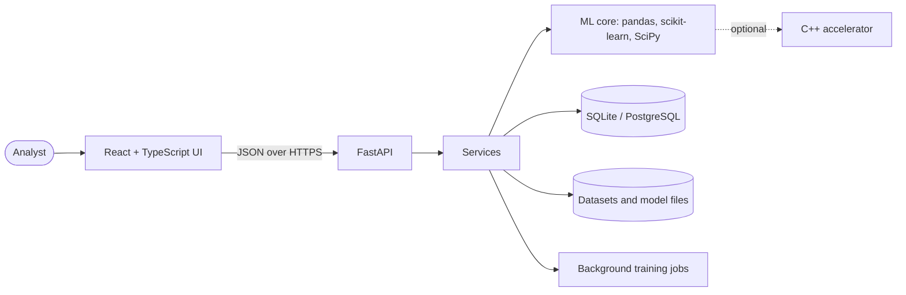

# NEXUS AI: Intelligent Decision and Prediction Platform

Author: **Rayyan Anwar**

NEXUS AI turns a table of data into predictions you can question. Upload a CSV (or load the bundled synthetic sample), check its quality, train and compare models, then get predictions that come with their uncertainty, an explanation, anomaly flags and drift checks. It runs locally with no paid service, external API or dataset download.

> **Honest status.** The ML core, SQL layer, security helpers, C++ accelerator and the frontend's library code were built *and tested* during development. The FastAPI service, database layer, React components, Docker images and CI workflows were written but could **not be executed** in the build sandbox (no network, so their dependencies could not be installed). Expect to fix small issues on your first run. The exact list is in [docs/VERIFICATION.md](docs/VERIFICATION.md) and [docs/STATUS.md](docs/STATUS.md). No badges are shown because CI has not run yet.

## Problem statement

Teams often have tabular data and a question ("which accounts are likely to churn?", "what will this cost?") but lack a workflow that is quick to run and honest about its limits. Typical failure points are silent data problems, evaluation that leaks test data, single numbers presented as facts, explanations mistaken for causes, and models left running after the data has changed. NEXUS AI addresses these directly: it reports data problems instead of hiding them, selects models on a validation split and touches the test split once, shows an interval or probability spread with every prediction, labels explanations as descriptions of the model, and compares new data against training data to flag drift.

## Key features

* **Data:** CSV upload with strict validation, column profiling, data-quality report (missing values, duplicates, invalid numbers, outliers), synthetic demo dataset.
* **Modelling:** automatic task detection (binary, multiclass, regression) with user confirmation; logistic/linear regression, random forest, gradient boosting; baselines; validation-based selection; test split evaluated once; leakage warnings; reproducible seeds.
* **Predictions:** single record or whole CSV, using the exact pipeline fitted in training; probabilities with a low-confidence flag, or conformal prediction intervals for regression; warnings for unseen categories and out-of-range values.
* **Explainability:** permutation importance with instability flags; per-record Monte-Carlo Shapley contributions with standard errors; explicit caveats that these describe the model, not causes.
* **Monitoring:** Isolation Forest anomaly detection with adjustable sensitivity and CSV export; drift analysis (PSI, KS, chi-square, Benjamini-Hochberg adjustment) with configurable thresholds.
* **Governance:** experiment records (dataset fingerprint, seed, versions, metrics), audit events, retention policy and deletion controls, downloadable HTML reports.
* **Engineering:** FastAPI + OpenAPI, token auth, rate limiting, upload limits, SQLite/PostgreSQL with Alembic, background training jobs, React + TypeScript UI, optional C++ accelerator, Docker Compose, GitHub Actions.

## Screenshots

No screenshots are committed yet, and none are mocked up. To capture genuine ones: start the app ([setup](#local-setup-without-docker)), click **Load synthetic demo data**, train a model, and save images of Overview, Model training, Predictions, Explainable AI and Data drift into `docs/screenshots/`, then link them here. See [docs/publishing-github.md](docs/publishing-github.md).

## Architecture



Details: [docs/architecture.md](docs/architecture.md).

## Technology stack

| Layer | Technology |
|---|---|
| Frontend | React 18, TypeScript, Vite, hand-written SVG charts, Vitest + Testing Library |
| Backend | Python 3.12, FastAPI, Pydantic v2, SQLAlchemy 2, Alembic |
| ML | pandas, NumPy, scikit-learn, SciPy, joblib |
| Data stores | SQLite (local default), PostgreSQL (production); files on disk for datasets and models |
| Native (optional) | C++17 via `ctypes`, with NumPy fallback |
| Delivery | Docker, Docker Compose, GitHub Actions, Makefile |

## Repository structure

```
.
├── backend/                  FastAPI app (app/api, core, db, ml, schemas, security, services), tests, Dockerfile
├── frontend/                 React + TypeScript UI, tests, Dockerfile, nginx.conf
├── services/cpp-accelerator/ Optional native kernels, C++ tests, benchmark
├── data/
│   ├── sample/               Synthetic CSV, ground truth, fixtures, DATA_CARD.md
│   └── generators/           generate_sample.py
├── database/
│   ├── migrations/           Alembic environment and versions (source of truth)
│   └── sql/                  Readable schema snapshot and parameterised queries
├── deployment/               docker-compose.yml, production override, cloud parameter table
├── docs/                     architecture, api, ml-methodology, security, deployment, results, benchmarks, STATUS, VERIFICATION
├── scripts/                  create_token.py, backup.sh, restore.sh, generate_results.py, static_check.py
├── models/                   Placeholder (model files are stored under the data directory)
├── .github/                  CI workflow and Dependabot
├── .env.example  .gitignore  Makefile  LICENSE  CONTRIBUTING.md  CODE_OF_CONDUCT.md  SECURITY.md  CHANGELOG.md
```

## Prerequisites

Python 3.12 (3.11 to 3.13 are declared), Node.js 20+ (22 used in CI), `git`. Optional: `g++` and `make` for the C++ accelerator, Docker with the Compose plugin.

## Local setup (without Docker)

```bash
python3 -m venv .venv && source .venv/bin/activate
pip install -r backend/requirements-dev.txt
make accel                                  # optional native library

# terminal 1: API on http://localhost:8000 (docs at /api/docs)
cd backend && uvicorn --factory app.main:create_app --reload

# terminal 2: UI on http://localhost:5173
cd frontend && npm install && npm run dev
```

Open the UI and use **Load synthetic demo data** on the Overview page.

## Docker setup

```bash
cp .env.example .env            # set POSTGRES_PASSWORD
make up                         # UI at http://127.0.0.1:8080
make down                       # stop (keeps data volumes)
```

Production override, TLS, PostgreSQL and cloud notes: [docs/deployment.md](docs/deployment.md).

## Environment configuration

All settings are `NEXUS_*` environment variables documented in [.env.example](.env.example): environment, database URL, data directory, CORS origins, upload limits, rate limit, retention days, token hashes. The `.env` file is git-ignored and `.env.example` holds placeholders only. Production mode refuses to start without tokens, with wildcard CORS, or on SQLite.

## Sample dataset

`data/sample/nexus_synthetic_accounts.csv` holds 2,000 **synthetic** rows (a fictional subscription business) generated with a fixed seed; nothing in it describes real people. It supports binary (`churned`), multiclass (`risk_tier`) and regression (`monthly_spend`) targets, and contains injected anomalies whose labels are kept in a separate file. Fixtures with deliberate missing values, invalid entries, duplicates and drift are in `data/sample/fixtures/`. Column definitions: [data/sample/DATA_CARD.md](data/sample/DATA_CARD.md). Regenerate with `make sample` (the output is byte-for-byte reproducible).

Because the relationships are written into the generator, results on this data demonstrate that the workflow works, not how a model would perform on real data. Real run results, including weak spots, are in [docs/results.md](docs/results.md).

## Model training workflow

1. **Dataset explorer:** upload or load data and review each column.
2. **Data quality:** read the findings; invalid numbers are treated as missing, not silently fixed.
3. **Model training:** confirm the target (suggestions are guesses), exclude columns that would leak the answer (for example other outcome columns), and start. Progress is shown while models train in the background.
4. **Experiment comparison:** see candidates on the validation split, held-out test results, the baseline, confusion matrix or residuals, and warnings.
5. **Predictions and Explainable AI:** predict for a record or a CSV, then see global importance and a per-record explanation.
6. **Anomaly detection and Data drift:** check the data you have, and check new data against training data.
7. **Reports and settings:** download a self-contained HTML report; delete data you no longer need.

## API examples

```bash
API=http://localhost:8000/api/v1
DS=$(curl -s -X POST $API/datasets/demo | python3 -c 'import sys,json; print(json.load(sys.stdin)["id"])')
curl -s -X POST $API/experiments -H 'Content-Type: application/json' \
  -d "{\"dataset_id\":\"$DS\",\"target\":\"churned\",\"exclude_columns\":[\"risk_tier\",\"monthly_spend\"]}"
```

Full reference with every endpoint, status codes and the error format: [docs/api.md](docs/api.md); interactive docs at `/api/docs`.

## Testing

```bash
make test-core      # ML, SQL and security tests with the standard-library runner (no web stack needed)
make test           # everything, via pytest (adds API, database and migration tests)
make test-web       # frontend: library tests (tsx) and component tests (vitest)
make accel-test     # C++ tests under AddressSanitizer and UBSan
make lint           # ruff, eslint, tsc
make static-check   # offline undefined-name / unused-import check
```

What actually ran during development, with counts, is in [docs/VERIFICATION.md](docs/VERIFICATION.md).

## Cloud deployment

Container image for the API, managed PostgreSQL, a persistent disk for files, and any static host (or the provided nginx image) for the UI. Step-by-step checklist, CORS and migration notes: [docs/deployment.md](docs/deployment.md). Check each provider's current pricing and limits yourself; none are assumed to be free.

## Troubleshooting

| Symptom | Likely cause and fix |
|---|---|
| UI says "Cannot reach the server" | The API is not running or the dev proxy points elsewhere. Start the API on port 8000, or set `VITE_API_PROXY`. |
| HTTP 401 | Tokens are enabled. Paste a token under **Reports and settings** (kept in memory only). |
| HTTP 413 or "exceeds the upload limit" | Raise `NEXUS_MAX_UPLOAD_MB` (default 10) or reduce the file. |
| "Class ... has only N row(s)" | Classification needs at least 5 rows per class; merge or drop rare classes. |
| "At least 50 rows ... are required" | The target has too few valid values. |
| Training fails with a reference id | See the server log for that id; the UI shows only a safe message. |
| "Possible target leakage" warning | A feature is almost identical to the target; check how it is produced and exclude it. |
| `Production ... refuses to start` | Set token hashes, a non-wildcard CORS origin and a PostgreSQL URL. |
| Native accelerator "Not built" | Optional. Run `make accel`, or ignore it. |
| Compose says `POSTGRES_PASSWORD` is not set | Copy `.env.example` to `.env` and set it. |
| Install errors on very old Python/pandas | The stack was developed with pandas 3, NumPy 2, scikit-learn 1.8; older versions are untested. |

## Security and privacy notes

Token auth (hashes only), rate limiting, CORS allow-list, upload limits and validation, generated file names, path containment, CSV-injection protection, parameterised SQL, checksummed model files, redacted structured logs, safe error messages, retention and deletion controls, hardened containers. Limits you must know about: **no per-user data isolation**, in-process rate limiting, unencrypted data at rest unless you encrypt the volume, and model files that embed a small sample of training rows. Full list: [docs/security.md](docs/security.md). Nothing here constitutes a compliance assessment.

## Model limitations

Metrics come from a single random split and carry sampling uncertainty; classification probabilities are not calibrated; regression intervals are approximate and constant-width; there is no hyperparameter tuning, cross-validation, time-aware splitting or fairness assessment; explanations describe the model and are not causal; anomaly scores are not proof of fraud or error; drift thresholds are conventions. Details and a possible research direction: [docs/ml-methodology.md](docs/ml-methodology.md).

## Roadmap

* Run and fix CI end to end; commit lockfiles; add Playwright end-to-end tests.
* Cross-validation with confidence intervals; probability calibration; hyperparameter search.
* Optional XGBoost and SHAP backends.
* Queue-backed workers (and a Java orchestrator only if a measured need appears); per-user accounts and data isolation.
* Time-aware splits; fairness diagnostics; adaptive conformal intervals.

## Contributing

See [CONTRIBUTING.md](CONTRIBUTING.md) and the [Code of Conduct](CODE_OF_CONDUCT.md). Security issues: [SECURITY.md](SECURITY.md).

## License

MIT. See [LICENSE](LICENSE).

## Author

Created by **Rayyan Anwar**.
