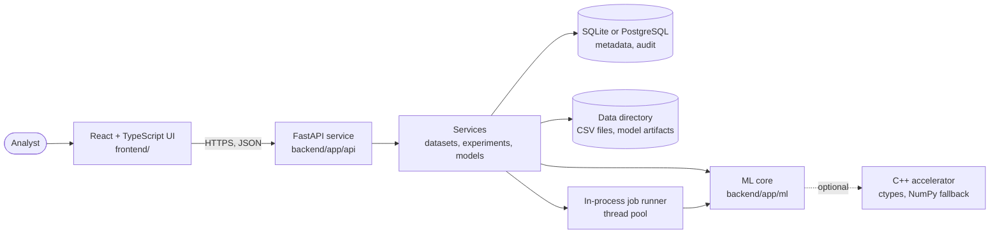

# Architecture

NEXUS AI is a small monorepo with one API service, one web UI and an optional native helper.



## Components

| Path | Responsibility |
|---|---|
| `backend/app/ml/` | Framework-free ML code: ingestion, profiling, quality, task inference, training, selection, prediction, explanations, anomaly detection, drift, reporting, artifact IO. Depends only on pandas, NumPy, scikit-learn and SciPy. |
| `backend/app/services/` | Orchestration: stores files and metadata, runs training jobs, enforces retention, records audit events. |
| `backend/app/api/` | Thin FastAPI routes, dependencies (auth, sessions), request validation. |
| `backend/app/db/` | SQLAlchemy models, engine/session handling, programmatic Alembic runner. |
| `backend/app/security/` | Token hashing and verification, rate limiter, safe file names and atomic writes. |
| `database/` | Alembic migrations (source of truth) and a readable SQL snapshot with parameterised analytical queries. |
| `frontend/` | Vite + React + TypeScript. Plain SVG charts, no chart library. |
| `services/cpp-accelerator/` | Optional C++ kernels loaded with `ctypes`; every call has a NumPy fallback. |
| `data/` | Synthetic sample data, fixtures and the generator CLI. |

The ML layer being independent of the web stack is deliberate: it can be tested without installing FastAPI, and reused from notebooks or scripts.

## Request flow: training

1. `POST /api/v1/experiments` validates the body (Pydantic), checks the dataset and target, and infers the task synchronously so unsupported targets fail fast with HTTP 422.
2. A row is stored with status `queued`; the response is `202 Accepted`.
3. A worker thread loads the dataset (verifying its SHA-256), runs `train_experiment`, writes the model artifact (with checksum) and updates the row. Progress and stage are written to the database as it goes.
4. The UI polls `GET /api/v1/experiments/{id}` until the status is `succeeded` or `failed`.

## Design decisions

* **In-process job runner.** A thread pool is enough for one instance and keeps local setup trivial. State lives in the database; on restart, unfinished experiments are marked failed rather than silently lost. For several API instances replace `JobRunner` with a real queue; the service functions already take plain identifiers.
* **Run one API worker.** Rate limiting is in-memory per process, and startup marks unfinished jobs as interrupted. Scale vertically or replace those two pieces first.
* **ctypes instead of pybind11 for C++.** No build-time Python dependency; the library is optional. See [benchmarks](benchmarks.md) for why it stays optional.
* **No Java service.** The prompt allowed an optional Java orchestrator only where it adds real value. The in-process runner covers current needs, and a second language would add maintenance cost without a measured benefit, so none is included.
* **Timestamps** are naive UTC in both SQLite and PostgreSQL.
* **JSON columns** (`JSON` type) hold profiles, summaries and metadata; raw dataset rows are never stored in the database.

## Data directory layout

```
<NEXUS_DATA_DIR>/
  datasets/ds_<random>.csv      # validated upload, generated name
  models/mdl_<random>.joblib    # model bundle; checksum is recorded in the database
```
